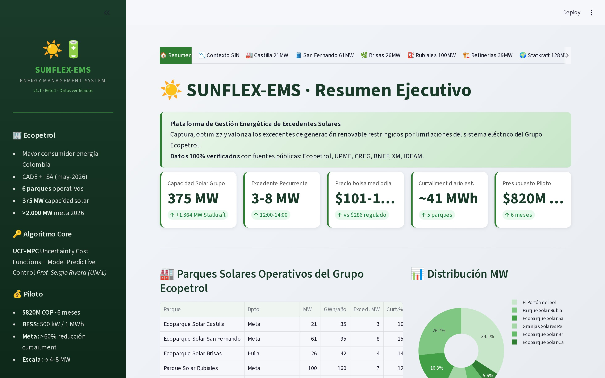
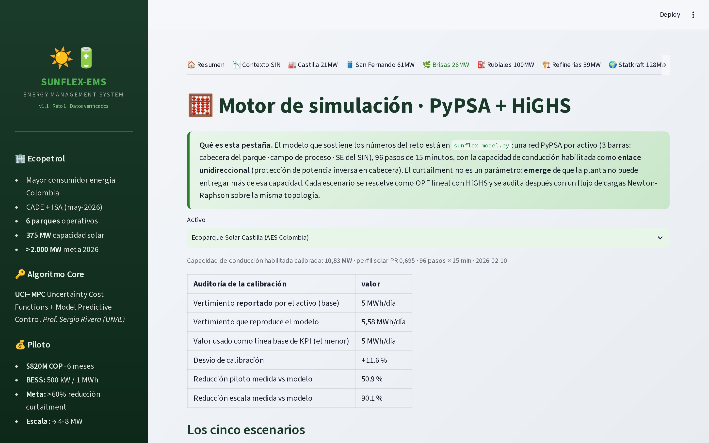
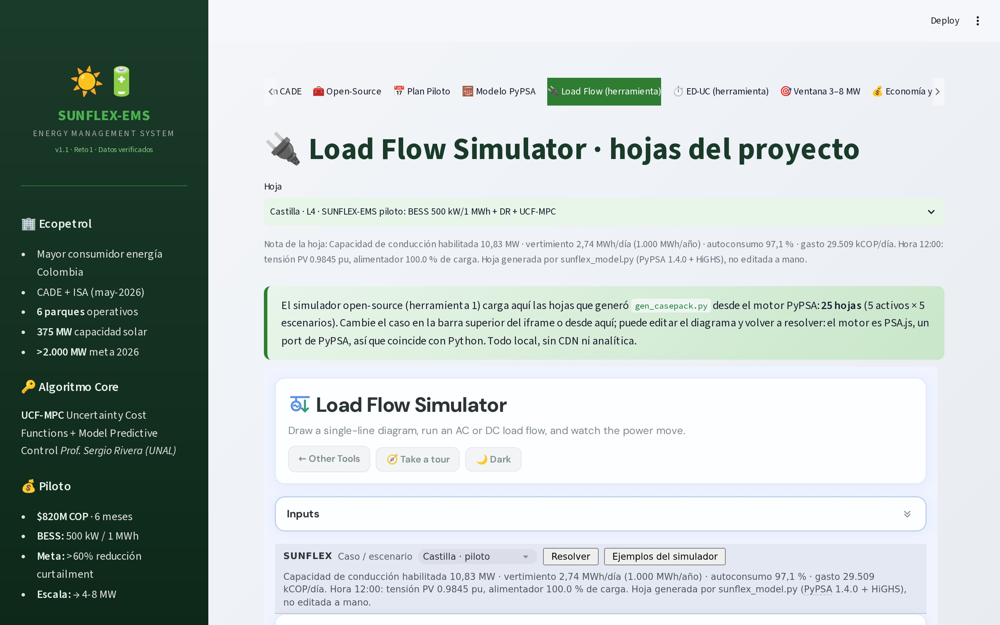
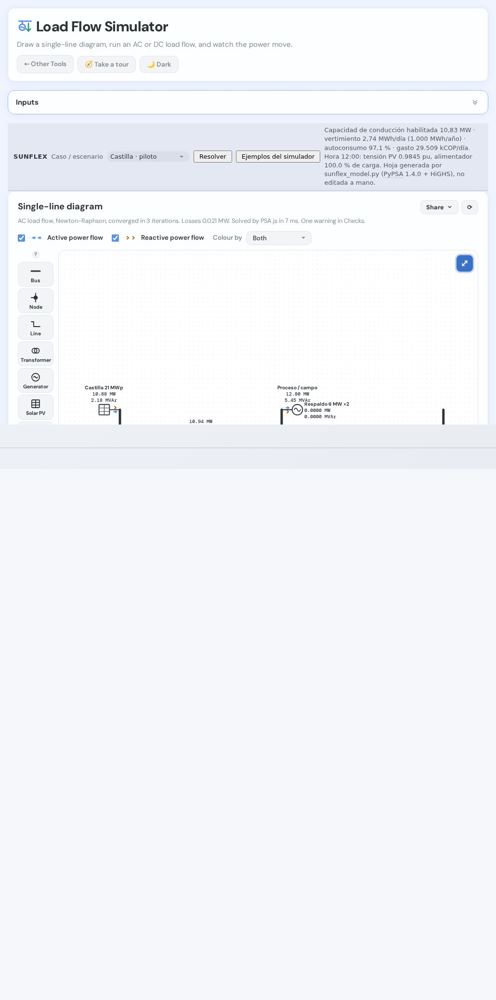
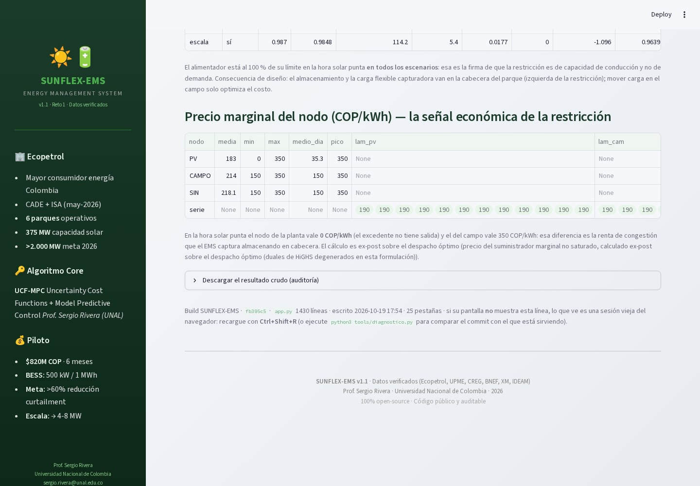

# SUNFLEX-EMS · propuesta al Reto 1 «Transforma la Energía»


<!-- sustituya USUARIO y, si quiere, añada el badge de Streamlit que aparece en docs/DEPLOY.md -->

Aplicación Streamlit + motor de simulación propio para el Reto 1 (aprovechamiento de
energía solar excedentaria, Ecopetrol / CADE). Los 25 apartados de la app salen del
mismo cálculo: no hay números escritos a mano.

**App desplegada:** <https://SUA-APP.streamlit.app> · **Cómo se despliega:** [`docs/DEPLOY.md`](docs/DEPLOY.md)

| | |
|---|---|
| 🧮 Motor | `sunflex_model.py` — red PyPSA por activo (3 barras), 96 pasos de 15 min, OPF con HiGHS, flujo de cargas Newton-Raphson y economía |
| 🔌 Herramientas | Load Flow Simulator y ED-UC Simulator (GPL-3.0), vendorizados y con 25 hojas propias cada uno |
| 📝 Documento | `docs/RESPUESTA_SUBSANACION.md` / `.docx` — los 5 reparos y todas las preguntas sin responder |
| ✅ Verificación | `output/verificacion_hojas.md` — 25/25 hojas LF convergen con el motor del navegador, 25/25 ED `ok/optimal` |

## Correr en local

```bash
python3 -m venv .venv && source .venv/bin/activate
pip install -r requirements.txt
streamlit run app.py
```

⚠ **`xarray>=2026.1` es obligatorio**: las imágenes base de Python y de Streamlit Cloud
traen 2025.x, que con PyPSA 1.4 revienta al armar el balance nodal con
`TypeError: Cannot interpret '<StringDtype(na_value=nan)>'`. `requirements.txt` lo
pinea y `sunflex_model.py` lo comprueba al importar (fallo en español, no un
`TypeError` críptico). `make install` o `bash tools/preview.sh` hacen lo mismo.

## Publicar (GitHub → Streamlit Community Cloud)

Este árbol ya trae su historial git hecho, así que solo falta el remoto:

```bash
git remote add origin https://github.com/SU-USUARIO/sunflex-ems.git
git push -u origin main           # el CI de .github/workflows/ci.yml empieza solo
gh run watch                      # opcional: ver el verde antes de seguir
```

Luego, en <https://share.streamlit.io/new> · **New app**: autorice el repo,
`Repository: SU-USUARIO/sunflex-ems`, `Branch: main`, **`Main file path: app.py`**
(esa ruta es la única que debe escribir a mano) → *Advanced settings* →
**Python version: 3.13** → *Deploy*. Tarda 1–3 min (`pip install -r requirements.txt`)
y queda en `https://sunflex-ems.streamlit.app`.

Cuando funcione: reemplace el enlace `SUA-APP.streamlit.app` y el `USUARIO` del badge
de arriba por los reales y vuelva a correr `python3 gen_docs.py` (el README se genera).

## Qué se ve, tabula por tabula

| pestaña | contenido |
|---|---|
| 🏠 Resumen → 📅 Plan Piloto (20) | la propuesta del repositorio base: contexto SIN, los 5 parques con sus sub-pestañas (Curtailment · BESS · DR · Pronóstico), mapa, UCF-MPC, regulación y CADE |
| 🧮 Modelo PyPSA (21) | calibración de la capacidad de conducción, los 5 escenarios L1–L5, curvas del día, flujo de cargas en dos horas críticas, precio marginal del nodo, JSON descargable |
| 🔌 Load Flow (22) | el simulador embebido con la hoja del caso elegido (25 hojas, motor PSA.js) |
| ⏱ ED-UC (23) | el mismo caso como despacho económico 24 h, modo EDM o UC |
| 🎯 Ventana 3–8 MW (24) | la rampa exigida por el Anexo 1 y la regla de despacho del EMS |
| 💰 Economía y TCO (25) | LCOS con precios BNEF, presupuesto por rubros, cronograma, ahorro por activo |

**25 pestañas.** Dos se podaron al armar `app.py` (`👤 Equipo` y `📝 Respuesta de
subsanación`): el equipo y la respuesta a los reparos van en `docs/` (Anexo 6,
`RESPUESTA_SUBSANACION.md`), que es donde los revisa el jurado, y no duplicados en la
app. La poda se hace en `build_app.py` con `assert` sobre el nombre y el bloque, y se
renumeran los índices restantes; `baseline/app.py` sigue verbatim para poder auditar el diff.

Capturas de la app (se regeneran con `python3 tools/capturas.py` con la app corriendo):

| | |
|---|---|
|  |  |
|  |  |
|  | [](docs/capturas/09-sello-build.jpg) |

Al pie de todas las pestañas la app pinta su **sello de build** (commit, líneas de
`app.py`, hora de escritura y nº de pestañas): si una pantalla no muestra esa línea, lo
que hay delante es una sesión vieja del navegador —el cuadro de excepción de Streamlit se
queda pegado cuando el servidor muere— y no un fallo real. `python3 tools/diagnostico.py`
(o `make diag`) lo confirma en 10 s comparando el commit con el proceso que sirve.

El último recuadro es el iframe por dentro: la hoja `Castilla · piloto` cargada en el
simulador (3 barras, 2 ramas, BESS en carga) y resuelta por su propio motor en 17 ms.

## Verificación (lo que puede repetir el jurado)

```bash
python3 sunflex_model.py                  # 5 activos × 5 escenarios, ~1 min
python3 gen_casepack.py                   # 25 hojas LF + 25 hojas ED
python3 tools/diagnostico.py              # ¿mi copia es la del repo? (make diag)
python3 tools/check_app.py                # las 25 pestañas headless, cero excepciones
make check                                # todo lo anterior
```

Resultado esperado: coincidencia con PyPSA de **≤ 0,0011 pu** en tensión y
**≤ 0,031 MW** en pérdidas (solo redondeo de la hoja); `ci.yml` corre esto mismo en
cada push.

## Estructura

| ruta | qué es |
|---|---|
| `app.py` | la app (generada: `baseline/app.py` verbatim + `tabs_sunflex_src.py`) |
| `build_app.py` | reconstruye `app.py` (no edite `app.py` a mano) |
| `baseline/` | copia verbatim del repositorio base, para el diff de auditoría |
| `data_reto1.py`, `algorithms_reto1.py` | datos y algoritmos del repositorio base |
| `sunflex_model.py` | **el motor**: perfiles, calibración, OPF, flujo de cargas, hojas LF/ED, economía, tablas del anexo |
| `gen_casepack.py` · `gen_docs.py` · `gen_habilitantes.py` | regeneran hojas, documentos y planillas |
| `tools/` | `verify_casepack.mjs` (check Node), `check_app.py`, `capturas.py`, `preview.sh` |
| `static/tools/` | las dos herramientas vendorizadas + `sunflex-cases.js`/`sunflex-boot.js` |
| `docs/` | respuesta de subsanación (`.md`/`.docx`), `DEPLOY.md`, guion del video, `habilitantes/` |
| `output/` | `casepack.json` y `verificacion_hojas.md`, committed para leer sin instalar nada |

## Licencias

`static/tools/` redistribuye las dos herramientas bajo **GPL-3.0** (con sus `LICENSE`),
y el motor usa **PyPSA/linopy/HiGHS bajo MIT**. Detalle y procedencia de los datos:
[`THIRD_PARTY_NOTICES.md`](THIRD_PARTY_NOTICES.md).

## Honestidad de los números

- El vertimiento **no es un dato de entrada**: emerge de una restricción de capacidad de
  conducción calibrada contra el valor reportado por cada activo (Rubiales declara +30 %
  de desvío porque su suelo físico no llega a la cifra de la fuente: se reporta, no se oculta).
- El ahorro es solo energía (bolsa). No se reclaman cargos por demanda, peajes ni garantías.
- Los `[COMPLETAR]` son verificables del proponente y se quedan vacíos a propósito.
- La meta «>60 % de reducción» se cumple en el escalado y en activos con flexibilidad
  co-localizada ≥ 3 MW; con el demostrador de 1 MWh el modelo da 41.7 % del
  portafolio (ver §6 del documento de respuesta).

*Consorcio: Consultoría Regulatoria S.A.S. · Kai Desarrollo S.A.S. · grupo del
Prof. Sergio Rivera (Universidad Nacional de Colombia).*
