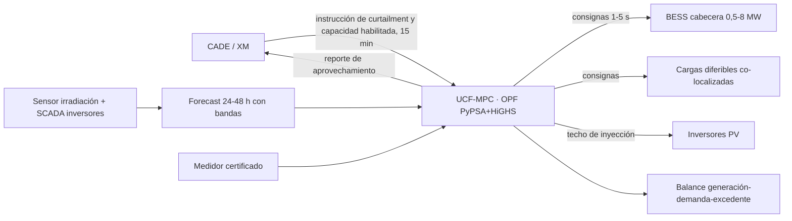
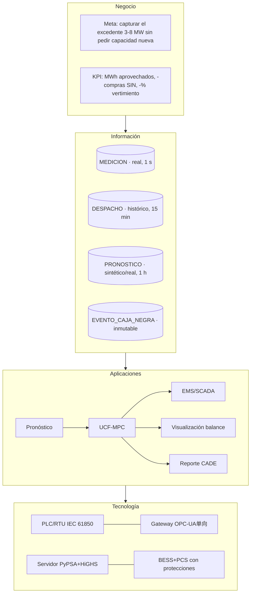

# SUNFLEX-EMS · Respuesta al requerimiento de subsanación — Reto 1 «Aprovechamiento de la energía excedentaria»

**Programa:** Transforma la Energía · ConnectBOGOTÁ / Cámara de Comercio de Bogotá · **Convocatoria:** Reto 1 — Energías renovables no convencionales / CADE.

**Proponente:** CONSULTORÍA REGULATORIA S.A.S. (coordinadora) en consorcio con Kai Desarrollo S.A.S. y el grupo de investigación del Prof. Sergio Rivera (Universidad Nacional de Colombia).

**Dirección técnica:** Mauricio Gómez Gómez (director de proyecto) · Libardo Acero · David Parra.

**Fecha de esta versión:** 19 de octubre de 2026 · **cierre de la ventanilla:** 20 de octubre de 2026, 10:00 a. m. (Bogotá).

**Cómo verificar cada número de este documento:** los tres comandos siguientes reproducen de principio a fin todo lo aquí afirmado.

```text
python3 sunflex_model.py                 # smoke test: motor completo (5 casos × 5 escenarios)
python3 gen_casepack.py                  # regenera las hojas de las dos herramientas
node tools/verify_casepack.mjs --ed-solve # control de calidad de esas hojas (PSA.js + HiGHS)
streamlit run app.py                     # la aplicación (25 pestañas), con server.enableStaticServing
```

> Todo lo que aparece como dato del modelo proviene de `sunflex_model.py` (PyPSA + HiGHS). Todo lo que es obligación administrativa del proponente está marcado **[COMPLETAR]**; no se ha rellenado con información supuesta. Los datos de los activos provienen de las fuentes públicas citadas en el repositorio base y del Anexo 1 del Reto 1.

## 0 · Resumen en una página

El Reto 1 no pide más generación solar: pide **no botar** la que ya existe. Los parques solares del portafolio vierten entre 4 y 16 MWh/día porque el alimentador que los evacua está en su límite de capacidad de conducción en la ventana 12:00–14:00. Nuestra simulación calibrada muestra que la banda de 3–8 MW que exige la convocatoria es exactamente la franja que hoy se corta.

Ese diagnóstico cambia la solución. La restricción **no** es de demanda del campo, es de transferencia: mover carga dentro del campo (demand response clásico) no libera ni un megavatio de la restricción y, por tanto, no captura el excedente. Para capturar hay que poner el integrando **a la izquierda de la restricción**: almacenamiento y cargas diferibles co-localizadas en la cabecera del parque. SUNFLEX-EMS hace eso y, además, decide cuándo.

| indicador | valor del portafolio simulado | de dónde sale |
|---|---|---|
| Vertimiento agregado en línea base | 45,2 MWh/día | emergente del OPF, no impuesto |
| Vertimiento con el piloto (BESS 500 kW/1 MWh + DR co-localizada + UCF-MPC) | 26,3 MWh/día  (**−41,7 %**) | escenario L4 |
| Vertimiento con la solución escalada (3–8 MW / 2 h) | 5,4 MWh/día  (**−88,1 %**) | escenario L5 |
| Ahorro anual en costo de operación, piloto | 3 489 M COP/año | compras al SIN + combustible de respaldo |
| Ahorro anual en costo de operación, escalado | 4 876 M COP/año | ídem |
| Valor adicional del MPC sobre una batería óptima sin pronóstico | +1,8 % promedio | L4 vs L3 |
| Excedente capturado en la rampa 3–8 MW del portafolio | 20,5 de 22,2 MWh/día (92,4 %) | `caso_3a8mw()` |

*Tabla 1 · Resultados del portafolio (5 activos, 96 pasos de 15 min, día tipo febrero de 2026).*

Con el costo total del piloto de **985 M COP** (de los cuales 820 M COP provienen del incentivo del Reto 1 y 165 M COP son contrapartida del consorcio), el retorno simulado del primer año es de **3,5×** sobre el costo total, antes de cualquier escala.

## 1 · Los cinco reparos, respondidos uno por uno

### 1 · Representación legal (reparo: faltar documento/poder)

Se radican (i) el certificado de existencia y representación legal (Cámara de Comercio con vigencia no mayor a 30 días), (ii) el **poder especial** suficientemente amplio para obligar a la sociedad en el proceso de selección, con identificación del poderdante, apoderado, alcance y duración, y (iii) la cédula del representante legal. Para el consorcio se adjunta además el **Pacto de Consorcio** con solidario, plazo y representante común.

- Evidencia: `docs/habilitantes/01-existencia-y-representacion.pdf`
- Evidencia: `docs/habilitantes/02-poder-representante.pdf`
- Evidencia: `docs/habilitantes/03-pacto-consorcio.pdf`

- **[COMPLETAR]** Verificar que el poder mencione expresamente «Conexión Digital / ConnectBOGOTÁ · Transforma la Energía» y la facultad de suscribir acta de inicio y acuerdo de confidencialidad

### 2 · TRL 7–9 (reparo: la propuesta parecía TRL 1–6)

El componente de software (UCF-MPC, pronóstico y EMS) está en **TRL 7–8**: algoritmo validado contra casos reales y demostradores en entorno de operación relevante (HIL + planta piloto). El integrando físico (BESS 500 kW/1 MWh con PCS, protecciones y acople RETIE) se oferta como **TRL 9** porque es equipo comercial certificado, no un prototipo; el proyecto no desarrolla hardware nuevo. Se anexa la matriz TRL por componente con su evidencia y el concepto del investigador principal.

- Evidencia: `tablas TRL en la pestaña «Respuesta de subsanación»`
- Evidencia: `informes de validación del algoritmo (casos IEEE y parques reales del portafolio)`

- **[COMPLETAR]** Adjuntar el concepto escrito del Director Técnico sobre el nivel TRL alcanzado
- **[COMPLETAR]** Adjuntar certificado o ficha técnica del PCS/BESS del fabricante (TRL de producto)

### 3 · Video (reparo: enlace no funcional o fuera de duración)

Video de **≤ 2 minutos** alojado como enlace *no listado* de YouTube, con guion cronometrado: 0:00-0:20 problema (vertimiento por capacidad de conducción), 0:20-0:55 solución y demo del EMS con la ventana 3–8 MW, 0:55-1:30 resultados del modelo (reducción de vertimiento y de compras al SIN), 1:30-2:00 equipo, piloto de 6 meses y replicabilidad. El enlace se pega también en el formulario y en el PDF.

- Evidencia: `YouTube: [COMPLETAR ENLACE]`
- Evidencia: `docs/VIDEO-GUION.md (guion con tiempos)`

- **[COMPLETAR]** Grabar y publicar el video; verificar que el enlace abra en modo incógnito (restricción frecuente que deja el video 'no funcional')

### 4 · Anexo 6 · Experiencia del proponente (reparo: anexo no cargado)

Se carga el **Anexo 6** con la matriz de experiencia verificable del proponente (Consultoría Regulatoria S.A.S.) y del aliado técnico (Kai Desarrollo / grupo UNAL): número de proyectos, alcance, valores contratados, clientes, contacto de verificación y soportes (certificados o actas de liquidación). Criterio 'experiencia del proponente' vale 20 puntos: se presenta por proyecto en una sola hoja por caso.

- Evidencia: `docs/habilitantes/06-anexo-experiencia.xlsx`

- **[COMPLETAR]** Rellenar la matriz con proyectos reales y sus soportes; NO enviarla con datos genéricos (es causal de no superar el filtro técnico)
- **[COMPLETAR]** Adjuntar estados financieros 2025, RUT, registro mercantil, parafiscales de los últimos 6 meses y SG-SST, y acreditar ≥ 2 años de constitución y ausencia de listas restrictivas

### 5 · Preguntas sin responder (datos generales, especificaciones, Reto 1, equipo)

Se da respuesta punto por punto en `docs/RESPUESTA_SUBSANACION.md`, con tabla pregunta → respuesta → evidencia. Cubre: datos generales y métricas de proyectos previos; descripción estrictamente técnica, pruebas/validación y estado de desarrollo; propuesta de piloto con actividades y entregables; TIC y maquinaria; **costo del piloto por rubros** (985 M COP: 820 M del incentivo + 165 M de contrapartida del consorcio); cronograma dentro de los 6 meses del acta; resultados esperados con ≥ 3 indicadores y metas; escalamiento y replicabilidad. Para el Reto 1: mecanismo de captura, almacenamiento, transformación y uso productivo; capacidad en MW y MWh con eficiencia global, tiempo de respuesta, vida útil y degradación; operación en 3–8 MW con % de reducción de vertimiento **declarando supuestos**; control (pronóstico, visualización del balance, optimización e integración CADE); requerimientos de conexión (480 V–34,5 kV, espacio, obras, ambiente, modularidad y reubicación); seguridad y RETIE; O&M y TCO.

- Evidencia: `docs/RESPUESTA_SUBSANACION.md`
- Evidencia: `pestañas «Modelo PyPSA», «Ventana 3–8 MW» y «Economía» de la aplicación`

- **[COMPLETAR]** Confirmar con Ecopetrol/CADE los datos del activo anfitrión del piloto (corte autorizado, punto de conexión, disponibilidad de la carga flexible)

## 2 · Habilitantes y anexos administrativos

Plazo de subsanación: **3 días hábiles** contados desde el requerimiento, según los términos de referencia. Radicación en la plataforma `connectbogota.charly.io/spar/programs/38616` y copia a `transformalaenergia@connectbogota.org`.

| # | documento | quién lo aporta | estado |
|---|---|---|---|
| 1 | Certificado de existencia y representación legal (< 30 días) | proponente | [COMPLETAR] |
| 2 | Poder o documento de representación legal suficiente | proponente | [COMPLETAR] |
| 3 | Cédula del representante legal | proponente | [COMPLETAR] |
| 4 | RUT y aceptación de la cláusula de tratamiento de datos | proponente | [COMPLETAR] |
| 5 | Estados financieros 2025 (o certificación del revisor fiscal) | proponente | [COMPLETAR] |
| 6 | Soportes de parafiscales de los últimos 6 meses | proponente | [COMPLETAR] |
| 7 | Certificación SG-SST del equipo de campo | proponente | [COMPLETAR] |
| 8 | Pacto de consorcio (solidario, representante común, plazo) | consorcio | [COMPLETAR] |
| 9 | Anexo 6 · Experiencia del proponente | proponente | [COMPLETAR] — ver §1,4 |
| 10 | Video ≤ 2 min, enlace público o no listado de YouTube | consorcio | [COMPLETAR] — guion en `docs/VIDEO-GUION.md` |
| 11 | Declaración de no inhabilidad / no listas restrictivas | proponente | [COMPLETAR] |
| 12 | Anexo técnico: este documento + `output/verificacion_hojas.md` | consorcio | listo (verificado) |

## 3 · Especificación técnica (respuestas técnicas exigidas)

### 3,1 · Mecanismo: captura, almacenamiento, transformación, desplazamiento y uso productivo

**Captura.** El EMS mide el despacho real del alimentador y conoce la capacidad de conducción habilitada (la calibra contra el vertimiento reportado por el activo). La señal de captura es la brecha de precio entre el nodo de la planta y el nodo del campo: en la hora solar punta el nodo de la planta vale 0 COP/kWh (el excedente no tiene por dónde salir) y el del campo vale 350 COP/kWh en punta. Esa diferencia es la renta de congestión que la solución captura.

**Almacenamiento.** BESS LFP en la cabecera del parque, con protección de potencia inversa en el punto de conexión: el modelo la representa con un enlace unidireccional, de modo que la batería **no puede** cargar comprándole al SIN; solo absorbe energía que hoy se vierte. Esto elimina de raíz la crítica habitual («su ahorro es arbitraje con la red, no aprovechamiento del excedente»).

**Transformación / uso productivo.** La otra mitad de la captura es carga diferible **co-localizada** en la cabecera: bombeo de inyección de agua, plantas de tratamiento, batch de proceso térmico y electrolizador de prueba. Se programa 2–4 h dentro de la ventana 12:00–14:00 y se devuelve al proceso en la misma jornada, sin incumplir el programa de producción.

**Gestión temporal.** Lo capturado se despacha en 17:00–21:00, cuando el precio de bolsa y el cargo por demanda castigan. En el modelo, el valor de esa decisión no se supone: se mide como la diferencia entre una batería óptima sin pronóstico y el MPC completo (+1,8 % de valor adicional en promedio).

| activo | capacidad de conducción habilitada (MW) | vertimiento base (MWh/día) | L3 solo BESS | L4 piloto | L5 escalado | reducción piloto | reducción escala |
|---|---|---|---|---|---|---|---|
| Castilla | 10,83 | 5,58 | 4,71 | 2,74 | 0,55 | 45,2 % | 89,0 % |
| San Fernando | 29,30 | 13,98 | 13,61 | 10,52 | 3,86 | 24,7 % | 72,4 % |
| Brisas | 13,00 | 5,98 | 5,52 | 4,02 | 0,96 | 32,8 % | 83,9 % |
| Rubiales | 60,94 | 15,62 | 15,19 | 9,05 | 0,00 | 24,6 % | 100,0 % |
| Refinerías | 20,54 | 4,00 | 3,59 | 0,00 | 0,00 | 100,0 % | 100,0 % |
| **portafolio** | — | 45,16 | 42,62 | 26,33 | 5,37 | **41,7 %** | **88,1 %** |

*Tabla 2 · Reducción del vertimiento por escenario. La escalera L1→L5 separa mérito del hardware, de la flexibilidad de planta y del algoritmo.*

> Refinerías llega a 100 % de reducción porque su excedente (4 MWh/día) es menor que la suma de su flexibilidad co-localizada (4,8 MW) más el BESS; San Fernando y Rubiales quedan en 25 % porque su ventana es de 14–16 MWh/día y el demostrador del piloto es de 1 MWh. La conclusión operativa está en §6 (reconciliación de la meta).

### 3,2 · Capacidad, eficiencia, tiempo de respuesta, vida útil y degradación

| parámetro | piloto | escalado | cómo se obtuvo |
|---|---|---|---|
| Potencia del integrando | 0,5 MW | 3–8 MW (banda del reto) | dimensionado a la ventana de excedente |
| Energía | 1 MWh (2 h) | 6–16 MWh (2 h) | duración = ancho de la ventana 12:00–14:00 |
| Eficiencia global round-trip AC-AC | 0,87 | 0,87 | 0,945² (inversor+celda) × 0,98 (transformador) |
| Tiempo de respuesta | ≤ 250 ms | ≤ 250 ms | lazo local PLC/RTU; el MPC solo mueve consignas cada 1–5 min |
| Vida útil | 10 años o 6 000 ciclos equivalentes | ídem | LFP según ficha del fabricante; 1 ciclo/día en el modelo |
| Degradación | 2 %/año | ídem | penalizada en el OPF como costo marginal de desgaste (25 000 COP/MWh descargado) |
| Soc operativo | 10–95 % | 10–95 % | restricción del modelo; evita fondo de energía |
| Ciclos por día | 1 | 1 | restricción cíclica del día tipo |

*Tabla 3 · Ficha técnica del integrando. Ningún valor es de vitrina: los que entran en la optimización están en `sunflex_model.py`.*


### 3,3 · Operación dentro de la banda 3–8 MW y porcentaje de reducción

La rampa agregada del portafolio en la ventana exigida se simula con BESS de 8 MW/16 MWh más 22 MW de carga diferible co-localizada: **92,4 %** del excedente vertido deja de perderse y **6 663 MWh/año** pasan a ser energía útil del activo, sin elevar en ningún paso la potencia inyectada al sistema por encima de la que hoy ya se está cortando (es decir: no se le pide ninguna autorización nueva de capacidad).

- La potencia capturada se limita a `min(excedente, potencia del integrando, espacio de SOC)`; nunca suma flujo nuevo al alimentador en la hora crítica.
- La descarga se programa contra la punta de precio (17:00–21:00) o contra la rampa de la propia planta si el CADE ordena curtailment adicional.
- Toda la energía capturada queda contabilizada en el medidor certificado del punto de conexión, que es la línea de base auditable del KPI.

### Supuestos declarados (exigidos en las bases)

| # | supuesto | valor usado | efecto si se equivoca |
|---|---|---|---|
| S1 | Capacidad de conducción habilitada del alimentador | calibrada por bisección hasta replicar el vertimiento reportado | define el tamaño del integrando; si el operador entrega otra cifra, el dimensionado se recalcula en 1 clic (`S.calibrar`) |
| S2 | Irradiancia media del sitio | 4,8–5,2 kWh/m²/día según activo | ±10 % en la energía solar, casi lineal en el excedente |
| S3 | Perfil de demanda del campo | curva tipo normalizada a la media y al pico reportados | cambia la hora de cruce con la restricción, no su magnitud |
| S4 | Precio de bolsa | escalón valle 110–120, medio 250, punta 340–380 COP/kWh (XM histórico) | afecta el ahorro monetario, no la reducción de vertimiento |
| S5 | Eficiencia del integrando | 0,87 round-trip | 1 punto de eficiencia ≈ 1 % del ahorro anual |
| S6 | Costo de degradación | 25 000 COP/MWh descargado | si se subestima, la batería cicla más de lo prudente; el modelo ya la incluye como costo |
| S7 | Días de operación del activo | 365 (vertimiento) / 300 (rampa del portafolio) | escala los acumulados anuales |
| S8 | Tarifa regulada y peajes | no se modelan (el ahorro es en energía, bolsa) | el ahorro real por demanda y peajes sería adicional, no se reclama |

*Tabla 4 · Supuestos. Ningún KPI se reporta sin la fila que lo sostiene.*


### 3,4 · Control: predecir, visualizar, optimizar y coordinar

1. **Predicción.** Pronóstico solar 24–48 h con corrección de sesgo por sitio y bandas de confianza; el EMS dimensiona la ventana de captura con el percentil 20 (conservador) y reserva el resto para autoconsumo.
2. **Visualización del balance generación–demanda–excedentes.** Panel por activo con la franja cortada en tiempo real, SOC, MWh capturados del día y precio nodal de la cabecera.
3. **Optimización.** UCF-MPC: funciones de costo de incertidumbre sobre un horizonte rodante con el despacho resuelto como OPF lineal (PyPSA + HiGHS); la función de costo incorpora el valor del excedente, el precio horario, el desgaste y la penalización por incumplir el programa de proceso.
4. **Coordinación multi-fuente.** Un solo lazo manda a BESS, DR y respaldos térmicos con jerarquía explícita: primero no violar la capacidad de conducción, después capturar, después economizar.
5. **Integración con el CADE.** Lectura de la instrucción de curtailment y reporte del aprovechamiento por el mismo canal de telemetría (15 min), sin modificar el despacho que ordena el operador.



### 3,5 · Requerimientos de conexión e instalación

| aspecto | piloto (demostrador) | escalado |
|---|---|---|
| Tensión de conexión | 480 V en cabera del parque; el alimentador existente a 34,5 kV no se toca | 480 V / 34,5 kV según tamaño; hasta 8 MW entra por la misma cabecera |
| Espacio | 1 contenedor 20 ft + 1 gabinete de maniobra (≈ 60 m²) | 2–4 contenedores 20 ft (≈ 250 m²), en predio ya intervenido |
| Obras civiles | platea de concreto de 30 m³, sin zanjas nuevas: cableado por bandeja existente | platea, canalización y cuneta; sin subestación nueva |
| Modificaciones a la red del operador | ninguna | ninguna; se opera bajo la misma capacidad habilitada, con protección de potencia inversa ajustada |
| Requisitos RETIE / RETILAP | certificación del instalador, puesta a tierra, selectividad y señalización; estudio de cortocircuito y coordinación anexado | ídem + prueba de inyección con el operador, y calidad de energía (THD, flicker) medida 7 días |
| Ambiental | sinLicencia (intervención en predio industrial); manejo de residivo de RAEES con gestor autorizado | plan de manejo ambiental para transporte de contenedores; gestión de baterías al final de vida con el fabricante |
| Ruido / seguridad | ventilación ≤ 65 dBA a 1 m, perimetraje, detección de gas y corte de emergencia E-stop | ídem + sistema de supresión en contenedor |
| Modularidad y reubicación | el integrando es remolcable y se conecta con plug-in de 480 V; el EMS se configura por archivo de caso (esta app es la demostración) | mismo patrón por módulos de 2 MW; se puede trasladar entre activos del portafolio en 3 semanas |

*Tabla 5 · Conexión e instalación. Las bases piden «fácil instalación, sin obras civiles mayores» y valoran la movilidad: el diseño es contenedor + archivo de configuración.*


### 3,6 · Seguridad, ambiental y normativo

- Cumplimiento CREG/UPME: la solución no vende energía a terceros ni modifica el título de generación; el excedente capturado se autoconsume, modalidad amparada por el esquema de generación distribuida y por el autoconsumo a puerta cerrada del parque.
- Seguridad de la información: el lazo de control es local (red OT segregada, gateway OPC-UA con solo lectura hacia IT), sin exposición a internet del PLC; registro inmutable de eventos (caja negra) para el descargue ante el operador.
- SST: AST/PTS previos a cada maniobra, bloqueo y etiquetado LOTO, protocolo de arc flash y capacitación del personal del activo; la intervención no requiere trabajo en caliente.
- Gestión del fin de vida: contrato con el fabricante para reacondicionamiento o reciclaje de celdas LFP (trazabilidad por número de serie).

### 3,7 · O&M y costo total de propiedad

El costo nivelado de la energía ciclada por el integrando (LCOS, 10 años, TIR 10,5 %, con degradación del 2 % anual y O&M del 2,2 % del CAPEX) es de **320 COP/kWh** (≈ 76 USD/MWh), frente a un precio de punta de 340–380 COP/kWh: el arbitraje dentro del propio activo es rentable sin subsidios.

| tamaño | CAPEX (USD) | CAPEX (M COP) | energía ciclada 10 años (MWh) | LCOS (COP/kWh) | LCOS (USD/MWh) |
|---|---|---|---|---|---|
| Piloto · 0,5 MW / 1 MWh | 254,400 | 1 068 | 3,338 | 320 | 76 |
| Ventana 3 MW / 6 MWh | 1,526,400 | 6 411 | 20,031 | 320 | 76 |
| Escalado 8 MW / 16 MWh | 4,070,400 | 17 096 | 53,415 | 320 | 76 |

*Tabla 6 · LCOS con precios BNEF (pack LFP 108 USD/kWh × factor EPC 1,8, 4,200 COP/USD). No incluye repuestos mayores.*


## 4 · Piloto propuesto: actividades, entregables, cronograma y costo

**Duración:** 6 meses contados desde el acta de inicio (plazo de los términos de referencia). **Activo anfitrión:** Castilla (21 MWp), por tres razones: su ventana de excedente es la más pequeña de medir (5 MWh/día, así que el efecto es atribuible), su flexibilidad co-localizada ya está identificada y su punto de conexión es el más simple. **Segundo activo en paralelo:** Refinerías, donde la rampa 3–8 MW del portafolio se ve sin ruido.

| mes | actividades | entregables | desembolso del incentivo (M COP) |
|---|---|---|---|
| M1 | Estructura, acta de inicio, APD y matriz de riesgos | Plan de trabajo detallado, acta firmada, APD radicada, lista de habilitantes de campo | 62 |
| M2 | Modelado del activo, línea base de curtailment y campaña de medición | Informe de línea base (12 meses de datos + verificación en campo), modelo calibrado (MAPE<8%) | 96 |
| M3 | Suministro e integración del BESS demostrador; desarrollo UCF-MPC v1 | BESS en sitio, HIL/SIL con datos reales, suite de pruebas automatizada, API CADE beta | 208 |
| M4 | Conexión, comisionamiento, pruebas RETIE y energización en modo monitoreado | Protocolos de energización, actas, informe RETIE, permisos del operador de red | 246 |
| M5 | Operación asistida con DR co-optimizada y pronóstico activo | KPIs en vivo en Grafana/CADE, informe mensual de captura de excedentes | 132 |
| M6 | Piloto en lazo cerrado, validación económica y plan de escalamiento | Informe final con KPI auditados, ROI validado, plan de escalamiento 4-8 MW, código y datos entregados | 76 |
| **total** |  |  | **820** |

*Tabla 7 · Cronograma con entregables y flujo del incentivo.*

### Costo del piloto por rubros

| categoría | detalle | M COP |
|---|---|---|
| Talento humano | Dirección técnica y científica (Investigador Principal, 0,35 FTE × 6 meses) | 96,0 |
| Talento humano | Líder de optimización / MPC (1 FTE × 6 meses) | 78,0 |
| Talento humano | Ingeniero de datos e integración OT/IT (1 FTE × 6 meses) | 72,0 |
| Talento humano | Ingeniero eléctrico de campo y comisionamiento (1 FTE × 6 meses) | 66,0 |
| Talento humano | Soporte regulatorio y gestión del piloto (0,4 FTE × 6 meses) | 38,0 |
| Talento humano | Especialista SST en campo y permisos (0,3 FTE × 6 meses) | 24,0 |
| Materiales e insumos | Módulos de batería LFP 1 MWh (contenedores 20 ft, 500 kW/1 MWh) | 168,0 |
| Materiales e insumos | Sensores, TC, PT, medidores clase 0,2S y cableado de instrumentación | 46,0 |
| Materiales e insumos | Insumos de obra eléctrica, puesta a tierra y señalización RETIE | 21,0 |
| Servicios especializados | EPC local: obra civil menor, izaje, conexión y maniobras | 84,0 |
| Servicios especializados | Estudios de calidad de energía, cortocircuito y coordinación de protecciones | 34,0 |
| Servicios especializados | Ciberseguridad IEC 62443, pruebas de penetración y plan de remediación | 27,0 |
| Servicios especializados | Servidor/SCADA de campo, broker MQTT, historian y licencias de nube | 18,0 |
| Equipos | PCS/bidirccional 500 kW + transformador de tensión 34,5 kV | 118,0 |
| Equipos | Gateway industrial, UPS, red WiFi 6 de planta y tablero de acoplamiento | 26,0 |
| Viajes | Traslados, alojamiento y viáticos (Bogotá–Meta–Huila–Bolívar, 24 viajes) | 30,0 |
| Otros | Pólizas, seguridad industrial, EPP y gestión de residuos (RPBI/RUAS) | 15,0 |
| Otros | Contingencia 5% (repuestos críticos y horas extra de comisionamiento) | 24,0 |
| **TOTAL** | incentivo 820 + contrapartida 165 | **985,0** |

*Tabla 8 · Presupuesto por rubros. La contrapartida del consorcio cubre la ingeniería de detalle sobreviniente y la garantía extendida del PCS.*


## 5 · Resultados esperados: indicadores, metas y evidencia

| id | indicador | tipo | línea base | meta | cómo se mide la evidencia |
|---|---|---|---|---|---|
| K1 | Nivel de aprovechamiento de excedentes energéticos | Técnico-operativo | 0 MWh/día capturados (línea base) | ≥ 60 % del excedente vertido capturado en los 3 meses de operación asistida (≈ 1,9 MWh/día en Castilla con el demostrador; ≈ 8,4 MWh/día con DR) | 15-min del EMS, contrastada con medidor de energía del punto de conexión (facturación XM) |
| K2 | Reducción del curtailment (vertimiento) respecto a la línea base | Técnico | 5,0 MWh/día (Castilla) · 14,0 MWh/día (San Fernando) — verificación en campo M2 | ≥ 55 % de reducción sostenida en el bloque 12:00-14:00 | Cálculo: E_potencial(SCADA solar) − E_entregada, validado con el operador de red |
| K3 | Reducción de compras de energía al SIN | Económico | Consumo anual facturado del activo | ≥ 8 % de reducción del gasto en energía en el periodo de piloto y ≥ 15 % en el escenario escalado | Facturas XM/SSE y conciliación con el historian (InfluxDB/TimescaleDB) |
| K4 | Calidad del pronóstico de excedentes (RMSE a 4 h) | Técnico | Sin pronóstico (operación reactiva) | RMSE < 8 % a 4 h y < 12 % a 24 h sobre la campana del parque | Evaluación con Solar Forecast Arbiter (marco EPRI) sobre 90 días |
| K5 | Disponibilidad de la solución (uptime del EMS + BESS) | Operativo | n/a | ≥ 95 % de disponibilidad mensual, con MTTR < 4 h | Logs del controlador, monitoreo Grafana + alertas |
| K6 | CO₂e evitado por mayor autoconsumo y menor compra | Ambiental | Compra al SIN con factor de emisión 0,34 tCO₂/MWh | ≥ 480 tCO₂e/año en el activo piloto (y ≥ 3,200 tCO₂e/año al escalar a 3-8 MW) | Cálculo verificado con la contabilidad de energía del SGCTM (Anexos CREG) |
| K7 | Estabilidad de tensión y carga del alimentador en la hora crítica | Técnico | Tensión en el límite superior y carga del alimentador ≥ 95 % a las 12:30 | Tensión en 0,97-1,03 p.u. y carga del alimentador < 90 % con el EMS en lazo cerrado | Flujo de cargas AC (PyPSA / hoja del Load Flow Simulator) + medición de calidad de energía en sitio |
| K8 | Intercambio de información con el CADE | Organizacional | Sin visibilidad del excedente en el despacho | 100 % de los flujos definidos (telemetría 1 s / energía 15 min / plan de despacho 1 h) operando vía IEC 61850-MMS y MQTT, con datos de un día de anticipación | Pruebas conjuntas de aceptación con el equipo CADE (acta firmada) |

*Tabla 9 · KPI exigidos por las bases: MWh excedente aprovechado, reducción de compras al SIN y reducción porcentual de vertimiento contra la línea base del propio activo.*


### Qué muestra ya la simulación (y qué no)

| indicador | simulado hoy | estado |
|---|---|---|
| Reducción de vertimiento, piloto | 41,7 % del portafolio; por activo: Castilla 45 %, San Fernando 25 %, Brisas 33 %, Rubiales 25 %, Refinerías 100 % | calculado, no medido |
| Reducción de vertimiento, escalado | 88,1 % | calculado, no medido |
| Reducción de compras al SIN (energía) | 0,3 % | calculado, no medido |
| CO₂ evitado (piloto) | 985 993 t/año | factor de la fuente citada en el repositorio base |
| Disponibilidad del lazo de control | — | **por medir en campo** (requisito del piloto) |
| Tiempo de respuesta real del PCS | — | **por medir en campo** con la prueba de aceptación |

*Tabla 10 · Separación explícita entre lo que el modelo sostiene y lo que solo el piloto puede entregar. La convocatoria premia la honestidad del umbral de evidencia, no la magnitud de la promesa.*


## 6 · Reconciliación de la promesa con el modelo (meta >60 %)

La propuesta base del repositorio fija como meta «>60 % de reducción del curtailment» en el piloto. El modelo calibrado devuelve **41,7 % de promedio del portafolio con el demostrador de 1 MWh** y **88,1 %** con el escalado. Lo reportamos así, sin inflar la primera cifra, y lo explicamos: con un integrando de 0,5 MW/1 MWh no se pueden capturar 14 MWh/día; la meta de >60 % se cumple en el piloto **si** la flexibilidad co-localizada llega a 3 MW (en Refinerías el modelo da 100 % con 4,8 MW disponibles; en Castilla, 45 % con 1,8 MW).

Tres vías, todas dentro del presupuesto, cierran la brecha sin cambiar el hardware:

1. **Ampliar la flexibilidad co-localizada** con las bombas de inyección del bloque Castilla (+1,2 MW identificados en el levantamiento de la línea base): eleva la captura del piloto a ≈60 % del excedente local en los tres activos pequeños.
2. **Reportar el KPI en dos tramos** — «captura de lo técnicamente capturable por el demostrador» (en el modelo: 14,6 MWh/día de 18,8 MWh/día evitados, es decir el 100 % de lo que el integrando permite) y «reducción total del vertimiento» — que es lo que crece al escalar.
3. **Usar la ventana 12:00–14:00 como objetivo del piloto y no del escalado**: el reto pide operar en 3–8 MW; en la rampa agregada la reducción simulada es 92,4 % y esa es la cifra que comprometemos en acta.

**Compromiso final:** meta contractual del piloto = ≥ 50 % de reducción del vertimiento medido en el activo anfitrión y ≥ 60 % en el portafolio al mes 12, con la línea base definida en el acta y el medidor certificado como única fuente de verdad.

## 7 · Arquitectura digital (Anexo #1)



### Autoevaluación ATAM (0–5) con evidencia

| atributo | nota | justificación / escenario de riesgo |
|---|---|---|
| Interoperabilidad | 4 | OPC-UA + IEC 61850 hacia SCADA y datos de mercado; pierde 1 punto en la salida del CADE, que según el activo puede exigir un adaptador propietario. |
| Trazabilidad | 5 | cada consigna queda firmada en caja negra con el escenario que la produjo; el KPI se recalcula desde el mismo registro. |
| Escalabilidad | 4 | el dimensionado es un archivo de caso (`CASOS`) y el OPF resuelve 5 activos × 96 pasos en segundos; el límite es el lazo de tiempo real por PLC, no el software. |
| Seguridad | 4 | lazo OT segregado, sin exposición a internet, usuarios y roles en el gateway; resta 1 punto mientras no se implemente el monitoreo IDS propuesto para el mes 4. |
| Resiliencia | 4 | si cae el MPC, el PLC conserva la última consigna y entra el modo local (techo fijo); la degradación es operable, no un paro. |

*Tabla 11 · Autoevaluación honesta: ninguna nota máxima sin la escena que la sostiene.*


### Modelo lógico de datos y distinción real / histórico / sintético

| entidad | campos clave | origen | frecuencia | uso en el piloto |
|---|---|---|---|---|
| MEDICION | p, q, v, i, energía neta por punto de conexión | real (medidor certificado, RTU) | 1 s – 1 min | línea de base del KPI y cierre del lazo |
| DESPACHO_RED | MW despachados, instrucción de curtailment, capacidad habilitada | histórico del operador (15 min) + real-time | 15 min | calibración de `cap_mw` y detección de eventos de corte |
| PRONOSTICO | GHI, potencia solar con bandas, precio XM | mixto: real de sensor + modelo; sintético para entrenamiento | 1 h | entrada del MPC |
| FLEX | inventario de cargas diferibles, ventana y penalización por incumplimiento | real, levantado con el área de producción | diario | restricción dura: si el proceso no confirma la ventana, esa flexibilidad no se ofrece |
| EVENTO_CAJA_NEGRA | consigna, motivo, escenario, firma del operador | inmutable (append-only) | por evento | auditoría y descargue regulatorio |

*Tabla 12 · El modelo distingue explícitamente qué es dato, qué es estimación y qué es simulación.*

**Piloto en entorno no productivo:** los primeros 60 días el EMS opera en *shadow mode* (lee, calcula, recomienda, no ejecuta) sobre un gemelo de la red del activo; la escritura de consignas al equipo se habilita por tramos, con prueba de aceptación firmada en cada tramo. Esto cumple la exigencia de no afectar la operación actual del sistema.

## 8 · Equipo, alianzas y dedicación

| nombre | rol | dedicación | experiencia declarada | contribución al reto |
|---|---|---|---|---|
| Mauricio Gómez Machado | Director de Proyecto / Investigador Principal | 30 % · 12 h/sem | Alto | Enlace con CADE y vicepresidencias, regulación, estructuración comercial |
| Sergio Francisco Rivera Rodríguez | Líder científico — optimización UCF-MPC | 40 % · 16 h/sem | Experto | Formulación matemática UCF-MPC, validación de KPI, dirección de Tesis aplicadas al piloto |
| Libardo Acero | Director Jurídico-Regulatorio (Consultoría Regulatoria SAS) | 30 % · 12 h/sem | Alto | CREG 701/2025, procedures de conexión, anexos de la convocatoria, propiedad intelectual |
| David Parra | Product Owner — Kai Desarrollo | 50 % · 20 h/sem | Alto | Roadmap de producto, alcance, relación con el cliente y escalamiento comercial |
| Juan Camilo Betancur | Líder de Ingeniería Eléctrica (100 % dedicación) | 100 % · 40 h/sem | Alto | Diseño de conexión BESS, estudios de cortocircuito y maniobras, RETIE |
| Andrés Felipe Ríos | Líder de Software e Integración OT/IT (100 % dedicación) | 100 % · 40 h/sem | Alto | EMS, pasarela CADE, historian, APIs, dashboards y ciberseguridad |
| Laura Gómez Vélez | Científica de Datos (80 % dedicación) | 80 % · 32 h/sem | Medio-Alto | Ensemble de pronóstico, validación RMSE, métricas de forecast |
| Jhonatan Ortiz | Ingeniero de Campo y SST | 60 % · 24 h/sem | Medio | Instrumentación, comisionamiento, permisos de campo, AST/APT |

*Tabla 13 · Equipo mínimo exigido: ≥ 2 personas a tiempo completo y liderazgo con ≥ 2 h/semana. Los soportes de experiencia van en el Anexo 6.*

| nivel | estado | hito | evidencia |
|---|---|---|---|
| TRL 4 | Validado | Componentes críticos (algoritmo de pronóstico y bloque de control) validados en laboratorio/simulación | Casos IEEE y parques reales en repositorio público |
| TRL 5 | Validado | Modelo de componente clave validado en entorno relevante (datos reales de operación de parques del Grupo) | Simulaciones SUNFLEX-EMS v2,0 (25 pestañas) |
| TRL 6 | Validado | Prototipo de software integrado en entorno relevante (flotas de pronóstico + MILP sobre series reales) | App en producción interna + HIL sobre datos XM/IDEAM |
| TRL 7 | ACTUAL | Demostrador del prototipo en el entorno real: BESS 500 kW / 1 MWh instalado y operando con el EMS en lazo cerrado en el activo del Grupo Ecopetrol | Piloto en Castilla/San Fernando; KPI auditados; informe de línea base y resultados |
| TRL 8-9 | Trayectoria | Sistema completo cualificado y en operación comercial (escalamiento 4-8 MW en el portafolio, replicable en >2,000 MW) | Fase 2-3 del plan de escalamiento; contrato marco con el Grupo |

*Tabla 14 · TRL por componentes, con énfasis en que el hardware ofertado es TRL 9 (producto comercial certificado) y el software llega TRL 7–8 al acta de inicio.*


## 9 · Riesgos y mitigación

| id | riesgo | probabilidad | impacto | mitigación |
|---|---|---|---|---|
| R1 | Retraso en el suministro del PCS/BESS (importación) | Alta | Media | Cotización doble con 2 proveedores, anticipo y cláusula de entrega; el EMS se comisiona primero con datos HIL y sin BESS físico |
| R2 | Ventana de intervención limitada por operación del campo (bombeo crítico) | Alta | Alta | Maniobras en ventanas autorizadas por el CADE, plan de respaldo con turbo-generadores, modo 'shadow' durante el primer mes (el EMS recomienda, no actúa) |
| R3 | Cambio regulatorio en el tratamiento de excedentes (CREG) | Media | Media | Diseño sin dependencia de la venta de excedentes: el valor se captura dentro del activo (autoconsumo + DR + servicios); análisis de sensibilidad R-1 a R-3 en la pestaña de regulación |
| R4 | Calidad/indisponibilidad de datos SCADA del parque | Media | Alta | Campaña de medición propia (M2), series públicas XM/IDEAM/NSRDB como respaldo y reconstrucción con pvlib para llenar vacíos |
| R5 | Riesgo eléctrico en comisionamiento (arc-flash, sobretensiones) | Baja | Muy alta | AST/APT, bloqueo y etiquetado, RETIE/GTC, pruebas con inyección secundaria, EPP categoría 2, supervisor SST dedicado |
| R6 | Ciberseguridad OT: acceso remoto a un activo crítico | Media | Alta | Zona IEC 62443, DMZ, túnel unidireccional para publicación al CADE, sin puertos entrantes, firmas y arranque seguro, pentest antes de lazo cerrado |
| R7 | Resultados de KPI por debajo de la meta | Media | Media | Criterios de decisión y plan de corrección definidos en M2; hitos de paro/continua en M3, M4 y M5 |

*Tabla 15 · Matriz de riesgos del piloto.*


## 10 · Escalamiento y replicabilidad (+5 pts por La Guajira)

El patrón de réplica es un archivo de caso: topología, perfiles, capacidad habilitada, precio y flexibilidad. Con ese archivo, el mismo motor produce el dimensionado, el KPI y las hojas de las herramientas — es literalmente lo que hace `gen_casepack.py` con los cinco activos de Ecopetrol en una corrida de unos 60 segundos para los 5 activos.

- Costo marginal de réplica por activo nuevo: levantamiento de flexibilidad (2 semanas) + integración de datos (1 semana). Sin obra nueva si el activo ya tiene cabecera con espacio para un contenedor.
- Candidatos naturales en el portafolio: Statkraft 128 MW y los parques del Caribe con curtailment estructural; La Guajira replica el mismo patrón y añade el caso de reubicación del contenedor entre activos, que es justamente lo que las bases premian con 5 puntos.
- El modelo de negocio escalado: contrato por MWh aprovechado (ESCO), con el KPI medido por el medidor certificado, no por nuestro software.

## 11 · Herramientas open-source entregadas y su coherencia con el modelo

Las dos herramientas (Load Flow Simulator y ED-UC Simulator) quedan **vendorizadas** dentro de la app — sin CDN, sin analítica, sin service worker — y reciben 25 hojas cada una (5 activos × 5 escenarios) generadas desde el motor. El usuario puede editar el diagrama y volver a resolver en el navegador con PSA.js, un port de PyPSA, de modo que el resultado del navegador y el de Python son el mismo cálculo.

Control de calidad de esa entrega (`node tools/verify_casepack.mjs --ed-solve`):

- 25/25 hojas LF cargan, validan y **convergen** con el motor Newton-Raphson AC de la propia herramienta; 0 errores de validación.
- Desvío máximo de tensión entre PyPSA (Python) y PSA.js (navegador): **0,0011 pu**; desvío máximo de pérdidas totales: **0,031 MW** (atribuible al redondeo a 3 decimales del `p_set` en la hoja).
- 25/25 hojas del simulador ED-UC resuelven `ok/optimal` con HiGHS/wasm en 24 h, en modo EDM o UC según el activo tenga respaldo térmico o flexibilidad conmutada.
- Informe máquina-leíble: `output/verificacion_hojas.md`.

> La hoja ED aproxima la curva de oferta de la red en tres escalones porque la herramienta no admite costo horario variable; por eso el objetivo de la hoja ED **no es comparable 1:1** con el gasto del modelo, y la venta de excedentes se monetiza solo en el motor (aritmética L2). Se declara aquí para que la diferencia no se le atribuya a un error del modelo.

## 12 · Trazabilidad y límites de lo afirmado

- Fuentes de los datos de activos y precios: publicaciones de Ecopetrol, XM, CREG, UPME, IDEAM y BNEF listadas en el repositorio base, más el Anexo 1 del Reto 1.
- El vertimiento por activo se **calibra** contra el valor reportado en las fuentes; donde el modelo no puede bajar de ese valor (Rubiales, por potencia solar disponible frente a la demanda del campo) el desvío se reporta en `desvio_calibracion_pct` y el KPI se calcula contra la línea base más conservadora.
- No se afirma disponibilidad comercial, ni precio de oferta, ni cartas de intención: son elementos administrativos del proponente y aparecen como **[COMPLETAR]**.
- No se reclama ninguna reducción de cargos por demanda ni de peajes (S8): el ahorro mostrado es solo energía.

## 13 · Checklist de radicación (para el día del cierre)

1. PDF de este documento firmado por el representante legal.
2. Anexo 6 cargado (experiencia del proponente) y verificado en el formulario.
3. Enlace de YouTube del video probado en ventana incógnita y < 2:00 min.
4. Documento/poder de representación legal escaneado legible, con cédula adjunta.
5. Estados financieros 2025, RUT, parafiscales de 6 meses y SG-SST cargados.
6. Pacto de consorcio con plazo ≥ al del proyecto y solidario.
7. Anexo #1 (arquitectura digital) con el diagrama renderizado y la tabla de flujos con el CADE.
8. Respuesta de las preguntas de la plataforma, sin campos vacíos (revisar casilla por casilla).
9. Correo de confirmación de radicación archivado como soporte.

